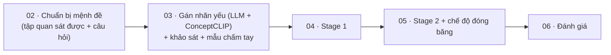

# 00 · Tổng quan đặc tả triển khai

*Bộ đặc tả này là nguồn để bám theo khi sửa code, chạy thực nghiệm, huấn luyện, kiểm tra và kiểm chứng. Lý do của từng lựa chọn nằm trong `CauChuyen_LuanVan_Final.md` (gọi tắt là **file câu chuyện**); ở đây chỉ dẫn số mục, không viết lại.*

---

## 1. Thứ tự thực hiện

Làm **từng file một**. Chỉ chuyển sang file tiếp theo khi file hiện tại đã đạt mục "Xong khi".



File 01 (bộ gán nhãn NLI) **không còn dùng**: khảo sát cho thấy nó gán "có" tràn lan, nên bộ gán nhãn văn bản được thay bằng LLM ở file 03. File 01 giữ lại chỉ để tham khảo.

| File | Đầu ra chính | Người duyệt trước khi đi tiếp |
|---|---|---|
| 01 | checkpoint bộ gán nhãn NLI | **không dùng nữa** |
| 02 | danh sách mệnh đề quan sát được và các câu hỏi đã tách | Trí duyệt 27 dòng `[Claude-v2]`, rồi agent chạy bước 5 với **bảng v2** |
| 03 | file nhãn yếu `weak_labels/v2` (LLM + ConceptCLIP), thống kê, mẫu chấm tay | **Trí xác nhận dry-run, xem pilot 47 ca, và chấm mẫu** |
| 04 | checkpoint Stage 1, ma trận điểm $S$, C1, C2 | Trí |
| 05 | dự đoán bệnh, `final_metrics.json`, C3 | Trí |
| 06 | bảng kết quả so với RAD và các kiểm tra | Trí |

---

## 2. Quy tắc chung (áp dụng cho mọi file)

1. **Không sửa** RAD baseline: `main_rad.py`, `engine/`, `models/`, `factory/`, `optim/`, `dataset/`.
2. **Không sửa** KB (`kb_propositions.json`) và các CSV của SkinCAP. Mọi lựa chọn trên mệnh đề (giữ hay loại, tách câu hỏi) được lưu thành **file riêng**.
3. **Không sửa** code P1 hiện có trong `proposition/`. Code mới đặt trong `proposition/weak/`, với entrypoint mới ở thư mục gốc, để P1/P2 vẫn chạy được như cũ.
4. Làm trên **branch mới tách từ `origin/P1`**, tên đề nghị: `WS`.
5. Train và test chạy trên **Colab**. Agent không tự commit hay push; Trí tự commit và push.
6. Mọi kết quả trung gian lưu trên Drive, **không ghi đè**: mỗi lần tạo lại thì tạo thư mục phiên bản mới (`v1`, `v2`…).
7. Mỗi thư mục kết quả có một `meta.json` ghi: ngày tạo, git commit, seed, phiên bản thư viện, SHA-256 của mọi file đầu vào (KB, CSV, checkpoint, file nhãn).
8. Seed mặc định là 42, dùng cùng hàm `seed_everything` như `main_proposition.py`.
9. Không đưa bất kỳ mô hình hay dữ liệu nào lên nơi công khai. Lý do: ConceptCLIP là model gated, và checkpoint NLI cũ dùng MedNLI (điều khoản PhysioNet). API key của LLM chỉ đặt trong biến môi trường hoặc Colab Secrets.

---

## 3. Quy ước đường dẫn

Đặt trong `configs/ws.yaml` và dùng chung cho mọi notebook và script:

```yaml
drive_root: /content/drive/MyDrive/K34
repo_dir:   /content/RAD-colab           # branch WS
skincap:
  train_csv:  <đường dẫn skincap_47_train.csv>
  val_csv:    <đường dẫn skincap_47_val.csv>
  test_csv:   <đường dẫn skincap_47_test.csv>
  image_root: <thư mục ảnh>
kb_path: kb_builder/outputs/final/kb_propositions.json
ws_root: ${drive_root}/WeakSup            # mọi kết quả của bộ đặc tả này
```

Cây thư mục kết quả:

```text
WeakSup/
├── propositions/v<k>/               # file 02
├── weak_labels/v<k>/                # file 03
└── runs/<run_name>/<timestamp>/
    ├── stage1/                      # file 04
    └── stage2_<mode>/               # file 05
```

---

## 4. Code mới (tổng hợp, chi tiết ở từng file)

```text
proposition/weak/
├── __init__.py
├── labels.py          # đọc file nhãn yếu, ánh xạ case_id → hàng, mệnh đề → cột   (03, 04)
├── propositions.py    # đọc danh sách mệnh đề quan sát được và câu hỏi           (02, 03, 04)
├── dataset.py         # wrapper dataset trả thêm case_id (không sửa dataset/)    (04)
├── llm_label.py       # LLM gán nhãn văn bản (bước A2)                           (03)
├── prompts/llm_label_v1.txt
├── losses.py          # masked BCE, tuỳ chọn pos_weight                          (04)
├── aggregation.py     # tổng hợp trên tập active: mean / weighted / group        (05)
└── metrics.py         # C1, C2, C3                                               (04, 05, 06)
main_ws_stage1.py
main_ws_stage2.py
notebooks/WS_02_propositions.ipynb
notebooks/WS_03_weak_labels.ipynb
notebooks/WS_03b_label_survey.ipynb
notebooks/WS_04_stage1.ipynb
notebooks/WS_05_stage2.ipynb
notebooks/WS_06_eval.ipynb
proposition/tests/weak/            # unit test cho mọi module mới
```

---

## 5. Từ vựng dùng chung

| Thuật ngữ | Nghĩa |
|---|---|
| `case_id` | tên file ảnh ở cột đầu của CSV SkinCAP (vd. `1761.png`), là khoá duy nhất của một ca |
| mệnh đề quan sát được | mệnh đề có `final_observable=1` trong `propositions_review_final.csv` (file 02; file câu chuyện mục 5.5); là các cột của ma trận nhãn và ma trận $S$ |
| tập tổng hợp $B_d^*$ | các mệnh đề quan sát được của bệnh *d* **có ít nhất `min_labels` nhãn (0 hoặc 1) trong train** (mặc định 5, chốt sau khảo sát), tính trên `label_final` sau bước LLM. Nếu rỗng thì dùng mọi mệnh đề quan sát được của bệnh *d* và ghi cờ `fallback`. Định nghĩa trong file 05 |
| câu hỏi (hypothesis) | câu dùng để hỏi bộ gán nhãn, sinh từ `canonicalDescription` (file 02) |
| nhãn yếu $r_{ij}$ | `1` có, `0` không, `-1` không đủ thông tin (∅) |
| $S$ | ma trận điểm mệnh đề $s_{ij}$ (ca × mệnh đề quan sát được) do Stage 1 tạo ra |
| C1, C2, C3 | ba kiểm tra cốt lõi (file 04–06) |

---

## 6. Điều agent phải làm trước khi bắt đầu mỗi file

1. Đọc file 00 và file đang làm.
2. Đọc các mục của file câu chuyện được dẫn trong file đang làm.
3. Trả lời ngắn: đầu vào là gì, đầu ra là gì, tiêu chí "Xong khi" là gì. Sau đó mới viết code.
