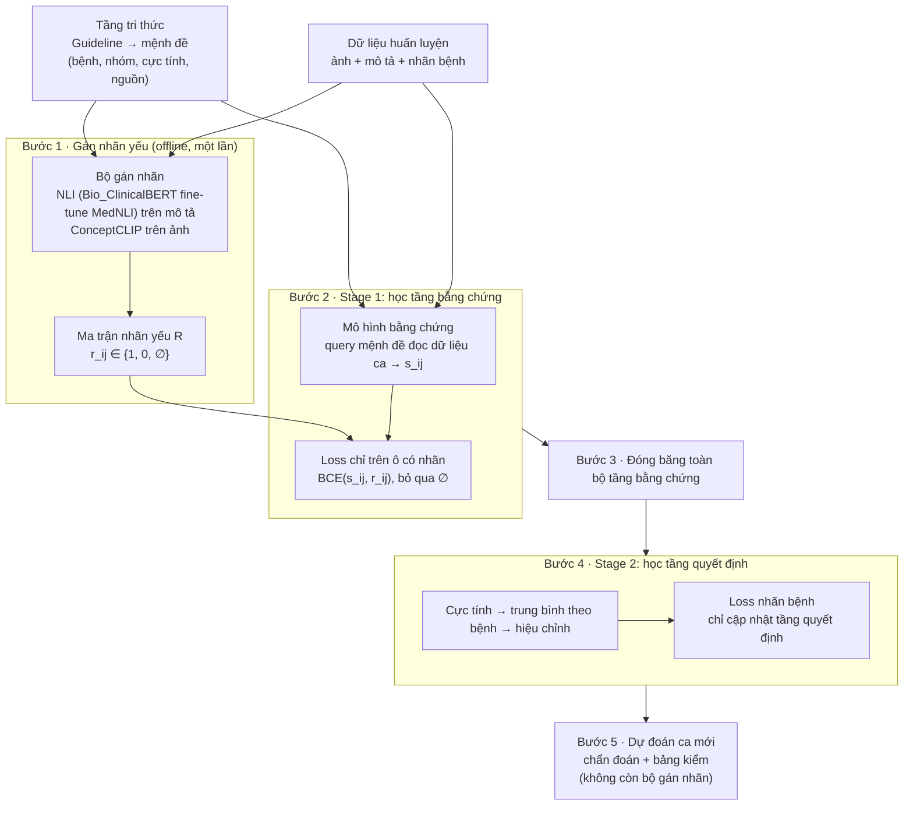
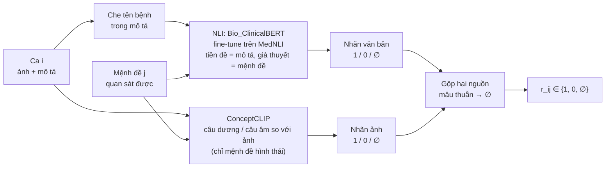
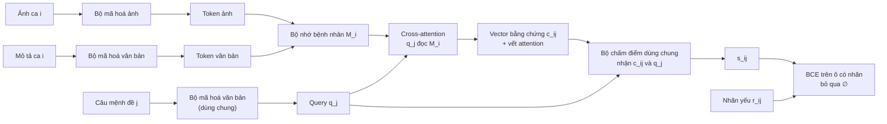
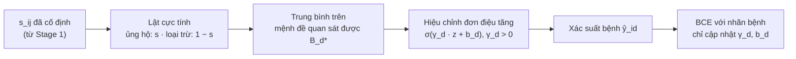
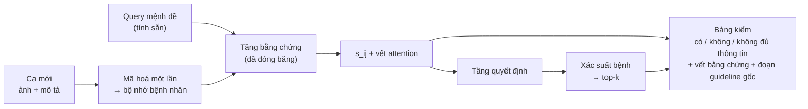

# Câu chuyện luận văn

*Tài liệu này là nguồn sự thật cho phần lập luận của luận văn sau khi đã chốt hướng đi cuối cùng. Nó trình bày bài toán, giới hạn của cách tiếp cận hiện có, phát hiện dẫn tới hướng mới, kiến trúc cuối cùng và lý do của từng lựa chọn. Chi tiết cài đặt, cấu hình và quy trình chạy thực nghiệm nằm ở tài liệu đặc tả triển khai riêng.*

*Các chỗ đánh dấu **[Cần trích dẫn: …]** là nơi khi viết luận văn phải tìm và trích nguồn gốc chính xác.*

---

## 1. Bài toán

Một hệ thống hỗ trợ chẩn đoán da liễu nhận vào dữ liệu của bệnh nhân (ảnh tổn thương và mô tả lâm sàng) rồi đưa ra các bệnh có khả năng. Với bác sĩ, câu trả lời "bệnh gì" chỉ có ích khi đi kèm câu trả lời "vì sao".

Khi lập luận chẩn đoán, bác sĩ đối chiếu ca bệnh với các **dấu hiệu chẩn đoán** của từng bệnh: tổn thương có giới hạn rõ không, có vảy không, phân bố ở đâu, có ngứa không. Sau đó họ cân nhắc dấu hiệu nào có, dấu hiệu nào không, và dấu hiệu nào chưa đủ thông tin để kết luận.

Vì vậy, một mô hình muốn hỗ trợ chẩn đoán đáng tin cần trả lời được hai câu hỏi:

1. Ca này có khả năng mắc bệnh nào?
2. Với từng dấu hiệu trong tri thức y khoa của bệnh đó, dữ liệu của ca này có cho thấy dấu hiệu ấy hay không?

Câu hỏi thứ hai là trọng tâm của luận văn.

---

## 2. Điểm xuất phát: RAD và giới hạn của tri thức ở mức bệnh

RAD (Li et al., 2025) đưa tri thức y khoa vào mô hình chẩn đoán đa phương thức:

1. Với mỗi bệnh, RAD truy xuất và tổng hợp một **guideline**, tức một đoạn văn mô tả bệnh, các dấu hiệu và chẩn đoán phân biệt.
2. Guideline được mã hoá thành query.
3. Query đọc dữ liệu bệnh nhân (token ảnh và token mô tả) bằng cross-attention để cho ra điểm của bệnh.

Ý tưởng *tri thức làm query, dữ liệu bệnh nhân làm bộ nhớ* là nền tảng mà luận văn kế thừa.

Tuy nhiên, trong RAD tri thức đi vào mô hình ở **mức bệnh**. Toàn bộ guideline của một bệnh, sau khi qua bộ mã hoá văn bản, bị nén thành **một vector query** cho mỗi cặp (bệnh, ca). Phần guideline vượt quá độ dài tối đa của bộ mã hoá còn bị cắt bỏ. Hệ quả:

- Mô hình chỉ cho ra một điểm cho mỗi bệnh. Không có cơ chế nào cho biết phần nào của guideline, tức dấu hiệu nào, đã đóng góp vào dự đoán.
- Bản đồ attention của RAD cho biết query mức bệnh đã nhìn vào vùng nào của ảnh hay mô tả, nhưng không cho biết vùng đó tương ứng với dấu hiệu nào trong tri thức.
- Vì vậy RAD trả lời được câu hỏi thứ nhất, nhưng không trả lời được câu hỏi thứ hai.

Đây không phải lỗi cài đặt mà là giới hạn của việc biểu diễn tri thức ở mức bệnh. Khi cả guideline đã thành một vector, ta không còn cách nào hỏi riêng từng dấu hiệu.

---

## 3. Ý tưởng: phân rã guideline thành mệnh đề

Để hỏi được từng dấu hiệu, tri thức phải được biểu diễn chi tiết hơn. Luận văn **phân rã guideline của từng bệnh thành các mệnh đề chẩn đoán**. Mỗi mệnh đề là một phát biểu ngắn về một dấu hiệu có thể kiểm tra độc lập, ví dụ "mảng đỏ giới hạn rõ", "vảy trắng bạc", "rỗ móng", "phân bố ở mặt duỗi".

Mỗi mệnh đề mang bốn thông tin:

- **bệnh** mà nó thuộc về;
- **nhóm:** hình thái, vị trí, triệu chứng, bệnh sử hoặc xét nghiệm;
- **cực tính:** dấu hiệu ủng hộ bệnh, hay dấu hiệu loại trừ;
- **trích dẫn tới đoạn guideline gốc**, để truy nguyên nguồn.

Trên bộ dữ liệu SkinCAP-47, cơ sở tri thức gồm 47 bệnh và 1.436 mệnh đề.

Với cách biểu diễn này, mỗi mệnh đề trở thành một query riêng. Mô hình cho ra một điểm $s_{ij}$ cho từng cặp (ca *i*, mệnh đề *j*), là mức dữ liệu của ca *i* cho thấy dấu hiệu *j*. Điểm của một bệnh được tổng hợp từ điểm các mệnh đề của bệnh đó, sau khi xét cực tính. Như vậy, cùng một bộ điểm vừa dùng để chẩn đoán, vừa hiển thị thành **bảng kiểm** cho bác sĩ: dấu hiệu nào có, dấu hiệu nào không.

Về cấu trúc, đây đúng là thứ cần để trả lời câu hỏi thứ hai. Câu hỏi còn lại là: **làm sao để điểm $s_{ij}$ thực sự mang nghĩa "ca *i* có dấu hiệu *j*"?**

---

## 4. Phát hiện then chốt: không có nhãn cho từng mệnh đề thì mệnh đề không mang nghĩa riêng

### 4.1 Lập luận

Trong bộ dữ liệu chẩn đoán thông thường, mỗi ca chỉ có **nhãn bệnh**, không có nhãn nào cho biết ca có hay không có từng dấu hiệu. Khi chỉ huấn luyện bằng nhãn bệnh, hàm mất mát chỉ ràng buộc **điểm bệnh sau khi tổng hợp**, không ràng buộc từng điểm mệnh đề.

Có vô số cách gán điểm cho các mệnh đề mà vẫn cho ra cùng một điểm bệnh. Trong số đó, cách dễ nhất với mô hình là:

- bật đồng loạt mọi mệnh đề của bệnh đúng;
- tắt đồng loạt mọi mệnh đề của các bệnh khác.

Gradient của nhãn bệnh lại được chia đều cho mọi mệnh đề trong cùng một bệnh, nên không có lực nào buộc mệnh đề này phải khác mệnh đề kia.

Nói đơn giản: **giáo viên chỉ chấm đáp án cuối, không chấm từng ô trong bảng kiểm.** Học sinh có thể điền cả bảng kiểm giống hệt nhau mà vẫn đạt điểm tối đa.

Trong học máy, hiện tượng này gọi là **tính không định danh của biến trung gian** (non-identifiability). Trong mô hình neuro-symbolic, nó là một dạng **reasoning shortcut** (Marconato et al., 2023): mô hình cho đúng đầu ra cuối, nhưng các khái niệm trung gian không mang nghĩa như thiết kế. Với mô hình nút thắt khái niệm, hiện tượng tương tự gọi là **rò rỉ khái niệm** (concept leakage; Koh et al., 2020; Margeloiu et al., 2021; Mahinpei et al., 2021): khi khái niệm và nhãn cuối được học chung, khái niệm bị kéo về phục vụ nhãn cuối thay vì mang nghĩa riêng.

### 4.2 Thực nghiệm kiểm chứng

Để kiểm chứng lập luận trên, luận văn chạy kiến trúc mệnh đề ở mục 3 trên SkinCAP-47 **chỉ với nhãn bệnh**. Không có nhãn hay ground truth nào giúp mô hình phân biệt các mệnh đề với nhau trên từng ca.

- **Về chẩn đoán:** độ chính xác top-1 khoảng 0,80–0,83, tương đương RAD (0,82). Nhìn từ đầu ra cuối, mô hình có vẻ hoạt động tốt.
- **Về mệnh đề:** điểm và attention cho thấy mô hình không đọc từng dấu hiệu.
  - Điểm mệnh đề bật hoặc tắt theo bệnh, không theo dấu hiệu. Tỉ lệ mệnh đề có điểm cao vượt 0,75 ở mọi nhóm, kể cả nhóm bệnh sử (0,81) và xét nghiệm (0,77), là những thông tin mà ảnh và mô tả tổn thương không chứa.
  - Bản đồ attention của từng mệnh đề gần như trùng với bản đồ trung bình của cả bệnh (tương quan khoảng 0,99). Các mệnh đề khác nhau cùng nhìn vào một chỗ.
  - Dự đoán của nhánh mệnh đề trùng với một nhánh đối chứng chỉ dùng tên bệnh làm query ở 539/546 ca kiểm tra.
- **Về độ bền của hiện tượng:** thay đổi cách biểu diễn query (cho học hoặc giữ cố định), hay cách tổ chức bộ nhớ bệnh nhân, đều không làm hiện tượng biến mất.

### 4.3 Kết luận

Phân rã tri thức thành mệnh đề là **điều kiện cần nhưng chưa đủ**. Thứ còn thiếu không nằm ở cơ chế đọc dữ liệu (query, cross-attention, tổng hợp), mà ở **tín hiệu huấn luyện**: mỗi mệnh đề cần được chấm điểm riêng trên từng ca.

---

## 5. Hướng giải quyết: giám sát yếu ở mức mệnh đề

### 5.1 Giám sát yếu là gì

**Giám sát yếu** (weak supervision) là các phương pháp huấn luyện khi không có nhãn chính xác, đầy đủ cho mọi mẫu. Mô hình học từ những tín hiệu rẻ hơn, kém chính xác hơn ground truth. Các tài liệu thường chia giám sát yếu thành ba dạng **[Cần trích dẫn: tổng quan về weakly supervised learning, ví dụ Zhou, 2018]**:

- **Giám sát không đầy đủ** (incomplete): chỉ một phần dữ liệu có nhãn.
- **Giám sát không chính xác về mức độ chi tiết** (inexact): nhãn chỉ có ở mức thô hơn mức cần học, ví dụ nhãn cho cả ảnh trong khi cần nhãn cho từng vùng.
- **Giám sát có nhiễu** (inaccurate): nhãn có thể sai.

Một hướng phổ biến là sinh nhãn tự động từ các nguồn có sẵn (luật, cơ sở tri thức, mô hình đã huấn luyện trước) thay vì gán nhãn tay. Các nguồn này được coi là nhiễu, và người ta thiết kế cách học chấp nhận được nhiễu đó **[Cần trích dẫn: data programming / Snorkel, Ratner et al.]**. Trong ảnh y khoa, một tiền lệ gần là trích tự động các phát hiện có / không / không chắc chắn từ báo cáo chẩn đoán hình ảnh để làm nhãn huấn luyện **[Cần trích dẫn: CheXpert labeler, Irvin et al., 2019; MedKLIP, Wu et al., 2023]**.

Theo cách nhìn này, phát hiện ở mục 4 được diễn đạt lại như sau:

- **Nhãn bệnh** là giám sát yếu dạng *không chính xác về mức độ chi tiết* đối với các mệnh đề. Nó chỉ nói "ca thuộc bệnh nào", không nói ca có dấu hiệu nào, và mục 4 cho thấy mức thô đó không đủ để học điểm mệnh đề.
- **Hướng của luận văn** là bổ sung một nguồn giám sát yếu **đúng mức chi tiết của mệnh đề**: chấp nhận nó *không đầy đủ* (nhiều ô không có nhãn) và *có nhiễu* (bộ gán nhãn có thể sai), nhưng đổi lại có tín hiệu riêng cho từng dấu hiệu trên từng ca.

### 5.2 Ý tưởng

Gán nhãn tay cho từng cặp (ca, mệnh đề) là không khả thi: hàng nghìn ca nhân với hàng trăm mệnh đề. Nhưng chính việc phân rã mở ra một lối khác. Vì mỗi mệnh đề là một phát biểu ngắn, kiểm tra được, nên có thể **dùng mệnh đề như một câu hỏi** đặt cho dữ liệu sẵn có của từng ca, và để một mô hình có sẵn trả lời tự động. Câu trả lời là **nhãn yếu**:

$$r_{ij} \in \{1\ (\text{có}),\ 0\ (\text{không}),\ \varnothing\ (\text{không đủ thông tin})\}.$$

Nếu không phân rã, điều này không làm được: không thể hỏi dữ liệu "ca này có khớp *cả guideline vảy nến* không" mà nhận về tín hiệu riêng cho từng dấu hiệu. **Phân rã chính là cầu nối giữa tri thức y khoa và giám sát theo từng ca.**

### 5.3 Ba nguyên tắc của nhãn yếu trong luận văn

**Nguyên tắc 1: "không đủ thông tin" khác "không có".** Mô tả lâm sàng không nhắc tới rỗ móng không có nghĩa là bệnh nhân không bị rỗ móng. Coi trường hợp này là 0 tức là dạy mô hình một điều sai. Các ô $\varnothing$ được loại khỏi hàm mất mát. Đây là cách luận văn xử lý tính *không đầy đủ* của giám sát yếu.

**Nguyên tắc 2: nhãn hỏi sự hiện diện của dấu hiệu, không hỏi dấu hiệu có ủng hộ bệnh hay không.** Với một dấu hiệu loại trừ, nhãn vẫn chỉ trả lời "ca có dấu hiệu này không". Việc dấu hiệu đó thuận hay nghịch với bệnh là tri thức, được xử lý sau bằng cực tính. Nhờ vậy, việc nhận diện bằng chứng và việc lập luận về bệnh tách bạch nhau.

**Nguyên tắc 3: nhãn yếu không phải ground truth, và kiến trúc không phụ thuộc bộ gán nhãn.** Bộ gán nhãn có thể sai; đây là tính *có nhiễu* của giám sát yếu. Luận văn không lập luận rằng nhãn đúng vì bộ gán nhãn tốt. Thay vào đó, kiến trúc được thiết kế như một **giao diện giám sát không phụ thuộc bộ gán nhãn**: bất kỳ nguồn nào trả về *có / không / không đủ thông tin* đều thay vào được. Khi có nguồn tốt hơn (nhãn của bác sĩ, bộ dữ liệu có chú thích khái niệm), chỉ cần thay nguồn nhãn, kiến trúc giữ nguyên.

### 5.4 Bộ gán nhãn

**Từ văn bản: suy diễn ngôn ngữ tự nhiên (NLI).** NLI là một bài toán chuẩn của xử lý ngôn ngữ. Cho một **tiền đề** (mô tả lâm sàng của ca) và một **giả thuyết** (mệnh đề), NLI xác định tiền đề **ủng hộ** (entailment), **phủ định** (contradiction) hay **không nói tới** (neutral) giả thuyết. Ba đầu ra này ánh xạ thẳng sang 1, 0 và $\varnothing$.

NLI khác đo độ tương đồng. "Mảng **không** có vảy" và "mảng có vảy" rất giống nhau về từ ngữ, nhưng NLI cho kết quả phủ định. Đo tương đồng cũng không có trạng thái "không nói tới".

NLI là một *bài toán*, không phải một mô hình cụ thể. Mô hình giải bài toán này thường là một bộ mã hoá họ BERT, đọc **cùng lúc** tiền đề và giả thuyết rồi phân loại thành ba nhãn. Để làm được việc đó, bộ mã hoá phải được huấn luyện thêm (fine-tune) trên một **bộ dữ liệu NLI**. Trong y khoa, bộ dữ liệu chuẩn là **MedNLI**: các cặp câu lấy từ ghi chú lâm sàng, được bác sĩ gán nhãn ủng hộ / phủ định / trung lập **[Cần trích dẫn: Romanov & Shivade, 2018]**. Luận văn dùng **Bio_ClinicalBERT**, cùng họ bộ mã hoá lâm sàng với RAD, fine-tune trên MedNLI làm bộ gán nhãn phía văn bản; bài giới thiệu Bio_ClinicalBERT cũng báo cáo đúng thí nghiệm này **[Cần trích dẫn: Alsentzer et al., 2019, kết quả trên MedNLI]**. Các bộ mã hoá khác đã được fine-tune sẵn trên MedNLI có thể dùng làm phương án so sánh. Lưu ý rằng MedNLI được xây từ ghi chú nội khoa, không phải mô tả tổn thương da, nên nhãn sinh ra vẫn là nhãn yếu và cần được đối chiếu với một mẫu chấm tay.

**Từ ảnh: mô hình ảnh–chữ.** Mô hình ảnh–chữ cho điểm mức một ảnh thể hiện một khái niệm (ví dụ "vảy", "ban đỏ"). Nó trả lời câu hỏi "ảnh trông có giống dấu hiệu này không", bổ sung cho NLI vốn trả lời "mô tả nói gì về dấu hiệu này".

Luận văn chọn **ConceptCLIP** (Nie et al., 2026) làm bộ gán nhãn phía ảnh, vì ba lý do:

- **Được thiết kế cho đúng nhiệm vụ gán khái niệm.** Ngoài căn chỉnh ảnh – văn bản ở mức toàn ảnh, ConceptCLIP còn căn chỉnh từng vùng ảnh với các khái niệm y khoa chuẩn hoá theo UMLS. Mỗi khái niệm được chấm bằng một cặp câu mô tả dương và âm, nên đầu ra tự nhiên là "có" hay "không có" khái niệm.
- **Kết quả gán khái niệm zero-shot tốt nhất trên loại dữ liệu của luận văn.** Trên tập SkinCon (ảnh lâm sàng từ Fitzpatrick17k, 22 khái niệm hình thái như sẩn, mảng, vảy, ban đỏ, vảy tiết), các tác giả báo cáo AUC 72,20, cao hơn BiomedCLIP (68,88) và cả MONET (67,30), vốn là mô hình chuyên cho da liễu. **[Cần trích dẫn: Bảng kết quả gán khái niệm zero-shot trong bài ConceptCLIP, bản Nature Biomedical Engineering 2026.]**
- **Dùng được cho nhiều chuyên khoa.** ConceptCLIP được huấn luyện trên khoảng 23 triệu cặp ảnh – văn bản y khoa thuộc nhiều phương thức (X-quang, CT, MRI, siêu âm, giải phẫu bệnh, nội soi, ảnh da, nhãn khoa…). Với ảnh xương, trên bài toán phân loại tổn thương cột sống zero-shot (VinDr-SpineXR), các tác giả báo cáo AUC 67,76, trong khi BiomedCLIP chỉ ở mức ngẫu nhiên (50,01). **[Cần trích dẫn: Bảng phân loại zero-shot trong bài ConceptCLIP.]** Nhờ vậy cùng một bộ gán nhãn có thể dùng cho cả da liễu lẫn cơ xương khớp.

Hai lưu ý đi kèm. Thứ nhất, độ chính xác tuyệt đối của việc gán khái niệm zero-shot vẫn còn khiêm tốn (AUC quanh 0,7), nên nhãn từ ảnh phải được coi là nhãn có nhiễu và chỉ lấy khi đủ chắc chắn. Thứ hai, với ảnh cơ xương khớp, các tác giả mới đánh giá ở mức phân loại bệnh, chưa đánh giá ở mức gán khái niệm. Các mô hình khác như MONET (Kim et al., 2024) hay BiomedCLIP (Zhang et al.) vẫn có thể dùng làm phương án so sánh. Việc có nhiều lựa chọn bộ gán nhãn, mỗi lựa chọn mạnh yếu khác nhau, là thêm một lý do để kiến trúc độc lập với bộ gán nhãn (nguyên tắc 3).

Bộ gán nhãn chỉ chạy **một lần, bên ngoài mô hình, trước khi huấn luyện**. Nó không có mặt khi mô hình dự đoán cho ca mới.

### 5.5 Tri thức đầy đủ và tập mệnh đề quan sát được

Không phải dấu hiệu nào cũng quan sát được trên mọi bộ dữ liệu. SkinCAP gồm ảnh tổn thương và mô tả tổn thương, không có bệnh sử, triệu chứng cơ năng hay kết quả xét nghiệm của bệnh nhân.

Luận văn phân biệt:

- **cơ sở tri thức đầy đủ:** toàn bộ mệnh đề phân rã từ guideline, giữ nguyên, không cắt tỉa;
- **tập mệnh đề quan sát được trên một bộ dữ liệu:** những mệnh đề mà dữ liệu của bộ đó *có thể chứa bằng chứng*, nên gán nhãn và học được.

Tiêu chí quan sát được là **bản chất của dấu hiệu so với loại dữ liệu**, không chỉ là nhóm của mệnh đề. Trên SkinCAP, tập này gồm các dấu hiệu hình thái và vị trí **biểu hiện trên da hoặc niêm mạc nhìn thấy được**. Một số mệnh đề tuy thuộc nhóm hình thái hay vị trí nhưng mô tả tổn thương ở cơ quan bên trong (phổi, thận, hạch, di căn…). Ảnh da và mô tả tổn thương không thể chứa bằng chứng cho những dấu hiệu này, nên chúng không thuộc tập quan sát được.

Mệnh đề ngoài tập quan sát được không bị coi là "không có". Chúng hiện trong bảng kiểm với trạng thái **"không đủ thông tin"** và không tham gia tính điểm bệnh. Khi chuyển sang bộ dữ liệu có bệnh án hoặc xét nghiệm, tập quan sát được tự mở rộng mà không cần thay đổi tri thức.

---

## 6. Kiến trúc cuối cùng

### 6.1 Tổng quan

Kiến trúc gồm **ba tầng**, mỗi tầng học từ một nguồn riêng, và vận hành qua **năm bước**:

| Tầng | Vai trò | Học từ |
|---|---|---|
| **Tri thức** | guideline → mệnh đề có dẫn nguồn và cực tính | tri thức y khoa (cố định, có sẵn trước) |
| **Bằng chứng** | (ca, mệnh đề) → điểm $s_{ij}$ | nhãn yếu mức mệnh đề |
| **Quyết định** | $s_{ij}$ → cực tính → tổng hợp → xác suất bệnh | nhãn bệnh |

Nguyên tắc xuyên suốt: *tri thức cho mô hình biết cần hỏi gì; giám sát yếu dạy mô hình nhận ra từng câu trả lời; nhãn bệnh chỉ được học cách kết hợp các câu trả lời đã học thành chẩn đoán.*

Các mục sau đi lần lượt từng bước. Một **ca minh hoạ** được dùng xuyên suốt. Lưu ý: ca này được dựng để giải thích, không phải một bản ghi thật trong bộ dữ liệu.

> **Ca minh hoạ.** Ảnh: tổn thương ở khuỷu tay. Mô tả: *"Nhiều mảng đỏ giới hạn rõ, phủ vảy trắng bạc, ở mặt duỗi khuỷu tay."* Nhãn bệnh: vảy nến.
>
> Một số mệnh đề dùng trong ví dụ:
>
> | Mã | Mệnh đề | Bệnh | Nhóm | Cực tính |
> |---|---|---|---|---|
> | A | mảng đỏ giới hạn rõ | vảy nến | hình thái | + |
> | B | vảy trắng bạc | vảy nến | hình thái | + |
> | C | rỗ móng | vảy nến | hình thái | + |
> | D | phân bố ở mặt duỗi | vảy nến | vị trí | + |
> | E | tiền sử gia đình có người bị vảy nến | vảy nến | bệnh sử | + |
> | F | dát đỏ ranh giới không rõ | chàm | hình thái | + |
> | G | mụn nước | vảy nến | hình thái | − (dấu hiệu loại trừ) |

### 6.2 Bước 1: gán nhãn yếu (offline)

**Mục đích.** Tạo cho mỗi cặp (ca, mệnh đề) một câu trả lời *có / không / không đủ thông tin*, để làm tín hiệu huấn luyện cho tầng bằng chứng.

**Những cặp nào được gán nhãn.** Mọi ca trong tập huấn luyện, ghép với mọi mệnh đề **quan sát được** (mục 5.5) của **mọi bệnh**, không chỉ bệnh đúng của ca. Lý do: nhiều dấu hiệu dùng chung giữa các bệnh. Một ca vảy nến vẫn có thể có "mảng đỏ" vốn cũng là dấu hiệu của bệnh khác. Mệnh đề không quan sát được (bệnh sử, triệu chứng, xét nghiệm, tổn thương cơ quan bên trong trên SkinCAP) không đưa vào bộ gán nhãn và mặc định là $\varnothing$.

**Nguồn văn bản (NLI).**

- Tiền đề là mô tả lâm sàng của ca. Tên bệnh trong mô tả được che lại khi gán nhãn, để bộ gán nhãn không suy ra dấu hiệu từ tên bệnh.
- Giả thuyết là câu mệnh đề.
- Kết quả ủng hộ / phủ định / không nói tới được chuyển thành 1 / 0 / $\varnothing$, **chỉ khi bộ gán nhãn đủ chắc chắn**. Trường hợp không chắc thì cho $\varnothing$; luận văn ưu tiên ít nhãn mà đáng tin hơn nhiều nhãn mà nhiễu.
- Mệnh đề được hiểu theo **nghĩa lâm sàng**, không theo nghĩa đen của từ nối. Nhiều mệnh đề liệt kê các vị trí hay gặp ("tổn thương ở mặt, ngực và lưng") hoặc các dạng biểu hiện thay thế ("sẩn hoặc nốt"). Ca có tổn thương ở *một* trong các vị trí đó, hoặc có *một* trong các dạng đó, là đã có dấu hiệu, không cần có đủ tất cả.

**Nguồn ảnh (ConceptCLIP).**

- Mô hình ảnh–chữ chấm khái niệm của mệnh đề trên ảnh bằng một cặp câu mô tả dương và âm, cho ra mức tin "có" so với "không có". Tin "có" rõ cho 1, tin "không có" rõ cho 0, ở giữa cho $\varnothing$.
- Chỉ áp dụng cho mệnh đề **hình thái**, tức đặc điểm của chính tổn thương có trong ảnh.
- Không áp dụng cho mệnh đề **vị trí**: ảnh không thấy móng hay mặt duỗi không có nghĩa là bệnh nhân không có tổn thương ở đó, chỉ là ảnh không chụp tới.

**Gộp hai nguồn.**

| Văn bản | Ảnh | Nhãn cuối |
|---|---|---|
| 1 | 1 hoặc $\varnothing$ | 1 |
| 0 | 0 hoặc $\varnothing$ | 0 |
| $\varnothing$ | 1 / 0 | theo ảnh |
| $\varnothing$ | $\varnothing$ | $\varnothing$ |
| 1 | 0 | $\varnothing$ (hai nguồn mâu thuẫn, không dùng) |
| 0 | 1 | $\varnothing$ (hai nguồn mâu thuẫn, không dùng) |

**Kết quả trên ca minh hoạ.**

| Mệnh đề | NLI trên mô tả | Ảnh | $r_{ij}$ | Giải thích |
|---|---|---|---|---|
| A. mảng đỏ giới hạn rõ | ủng hộ → 1 | điểm cao → 1 | **1** | mô tả nói rõ, ảnh khớp |
| B. vảy trắng bạc | ủng hộ → 1 | điểm cao → 1 | **1** | |
| C. rỗ móng | không nói tới → $\varnothing$ | ảnh không có móng → $\varnothing$ | **$\varnothing$** | không đủ thông tin, **không** phải "không có" |
| D. phân bố ở mặt duỗi | ủng hộ → 1 | (không áp dụng) | **1** | |
| E. tiền sử gia đình | (không quan sát được) | (không áp dụng) | **$\varnothing$** | ngoài tập quan sát được |
| F. dát đỏ ranh giới không rõ (chàm) | phủ định → 0 | (ví dụ: $\varnothing$) | **0** | mô tả nói "giới hạn rõ" |
| G. mụn nước | không nói tới → $\varnothing$ | điểm thấp → 0 | **0** | ảnh cho thấy không có mụn nước |

Kết quả của bước 1 là một **ma trận nhãn yếu** $R$ cho toàn bộ tập huấn luyện, lưu lại một lần và dùng cho bước 2.

### 6.3 Bước 2: học tầng bằng chứng (Stage 1)

**Mục đích.** Dạy mô hình tự đọc dữ liệu của ca và cho ra $s_{ij}$ khớp với nhãn yếu, để khi gặp ca mới nó trả lời được mà không cần bộ gán nhãn.

**Cách mô hình tính $s_{ij}$:**

1. **Mã hoá dữ liệu ca.** Ảnh qua bộ mã hoá ảnh thành các token ảnh; mô tả qua bộ mã hoá văn bản thành các token văn bản. Ghép lại thành **bộ nhớ bệnh nhân** $M_i$.
2. **Mã hoá mệnh đề.** Câu mệnh đề qua bộ mã hoá văn bản thành một vector **query** $q_j$.
3. **Đọc bằng chứng.** $q_j$ đọc $M_i$ bằng cross-attention: mỗi token trong bộ nhớ nhận một trọng số (attention), và tổng có trọng số của các token cho ra **vector bằng chứng** $c_{ij}$. Trọng số attention chính là *vết bằng chứng*: mệnh đề đã nhìn vào vùng nào của ảnh, từ nào của mô tả.
4. **Chấm điểm.** Một bộ chấm điểm dùng chung cho mọi mệnh đề nhận cả $c_{ij}$ và $q_j$, rồi cho ra $s_{ij} \in [0, 1]$.

**Hàm mất mát.** Chỉ tính trên các ô có nhãn:

$$\mathcal L_{concept} = \frac{1}{|\Omega|}\sum_{(i,j)\in\Omega}\text{BCE}(s_{ij}, r_{ij}),\qquad \Omega = \{(i,j) : r_{ij} \neq \varnothing\}.$$

Ô $\varnothing$ không tham gia. Mô hình vẫn tính $s_{ij}$ cho các ô đó, nhưng không bị phạt dù ra giá trị nào. Nhãn bệnh **không** dùng ở bước này.

**Tham số được học:** bộ mã hoá ảnh, bộ mã hoá văn bản (cho cả mô tả lẫn mệnh đề), cross-attention, bộ chấm điểm.

**Trên ca minh hoạ.** Sau khi học, mô hình được kỳ vọng cho $s$ cao với A, B, D (nhãn 1), thấp với F, G (nhãn 0). Với C và E, mô hình vẫn cho ra một con số, nhưng con số này không bị nhãn ép. Đây chính là chỗ khác với thiết kế chỉ dùng nhãn bệnh: A và F nhận nhãn ngược nhau trên cùng một ca, nên mô hình **buộc phải** đọc khác nhau cho hai mệnh đề, thay vì bật cả cụm theo bệnh.

### 6.4 Bước 3: đóng băng tầng bằng chứng

Sau Stage 1, **toàn bộ** tầng bằng chứng được đóng băng: bộ mã hoá ảnh, bộ mã hoá văn bản, cross-attention, bộ chấm điểm. Từ đây, $s_{ij}$ của mọi ca là cố định.

**Vì sao phải đóng băng toàn bộ, chứ không chỉ chặn gradient tại bước tổng hợp?** Nhãn bệnh có thể đi vào tầng bằng chứng theo nhiều đường, không chỉ qua điểm mệnh đề. Bộ mã hoá ảnh và văn bản là thành phần dùng chung: bất kỳ hàm mất mát mức bệnh nào chạm tới chúng (một nhánh phụ đoán bệnh, một hàm căn chỉnh biểu diễn theo nhãn bệnh) đều kéo biểu diễn về hướng nhận diện bệnh, và tạo lại đúng đường tắt ở mục 4. Chỉ khi tầng bằng chứng được đóng băng hoàn toàn trước khi nhãn bệnh xuất hiện, ta mới đảm bảo **tối ưu ở mức bệnh không có quyền sửa nghĩa của điểm mệnh đề**.

Cùng lý do đó, kiến trúc cuối cùng **không có** nhánh phụ đoán bệnh và **không có** hàm căn chỉnh biểu diễn dựa trên nhãn bệnh. Tín hiệu mức bệnh chỉ được dùng ở tầng quyết định.

Cách huấn luyện "học khái niệm trước, đóng băng, rồi học quyết định" tương ứng với kiểu huấn luyện **tuần tự** (sequential) của mô hình nút thắt khái niệm (Koh et al., 2020).

### 6.5 Bước 4: học tầng quyết định (Stage 2)

**Mục đích.** Học cách kết hợp các điểm mệnh đề đã cố định thành xác suất bệnh.

**Cách tính**, với mỗi ca *i* và mỗi bệnh *d*:

1. **Lật cực tính.** Dấu hiệu ủng hộ giữ nguyên điểm; dấu hiệu loại trừ đổi thành "điểm không có dấu hiệu":
   $$\tilde s_{ij} = \begin{cases} s_{ij} & \text{dấu hiệu ủng hộ} \\ 1 - s_{ij} & \text{dấu hiệu loại trừ} \end{cases}$$
2. **Tổng hợp.** Lấy trung bình $\tilde s_{ij}$ trên các mệnh đề quan sát được của bệnh *d*, ký hiệu $B_d^*$:
   $$z_{id} = \frac{1}{|B_d^*|}\sum_{j \in B_d^*}\tilde s_{ij}$$
3. **Hiệu chỉnh.** Một hàm đơn điệu tăng riêng cho từng bệnh chuyển $z_{id}$ thành xác suất:
   $$\hat y_{id} = \sigma(\gamma_d\, z_{id} + b_d),\quad \gamma_d > 0$$

**Hàm mất mát:** BCE giữa $\hat y_{id}$ và nhãn bệnh. Chỉ $\gamma_d, b_d$ được học.

**Vì sao trung bình đều?** Để điểm bệnh giải thích được trực tiếp bằng bảng kiểm: mỗi dấu hiệu đóng góp như nhau, và người đọc thấy ngay điểm bệnh cao vì những dấu hiệu nào. Các biến thể có trọng số (học trọng số không âm cho từng mệnh đề, hoặc cho từng nhóm mệnh đề như hình thái và vị trí) được xét qua thực nghiệm như phương án so sánh. **Vì sao hàm hiệu chỉnh phải đơn điệu tăng?** Để nhiều dấu hiệu ủng hộ hơn luôn dẫn tới xác suất bệnh cao hơn, không bao giờ ngược lại.

**Trên ca minh hoạ** (bệnh vảy nến; giả sử các mệnh đề quan sát được trong ví dụ là A, B, C, D, G):

| Mệnh đề | $s_{ij}$ | Cực tính | $\tilde s_{ij}$ |
|---|---|---|---|
| A | 0,92 | + | 0,92 |
| B | 0,88 | + | 0,88 |
| C | 0,30 | + | 0,30 |
| D | 0,85 | + | 0,85 |
| G | 0,08 | − | 0,92 |

$z = (0{,}92 + 0{,}88 + 0{,}30 + 0{,}85 + 0{,}92)/5 = 0{,}774$, rồi qua hiệu chỉnh ra xác suất vảy nến. Mệnh đề E (bệnh sử) không tham gia.

### 6.6 Bước 5: dự đoán cho ca mới

Khi gặp ca mới, **không còn bộ gán nhãn**:

1. Mã hoá ảnh và mô tả của ca **một lần** thành bộ nhớ bệnh nhân.
2. Chạy các query mệnh đề quan sát được qua tầng bằng chứng (embedding mệnh đề là tri thức tĩnh, tính sẵn được) để có $s_{ij}$ và vết attention.
3. Qua tầng quyết định để có xác suất từng bệnh.
4. Với các bệnh có xác suất cao nhất, dựng **bảng kiểm** từ chính các $s_{ij}$ đã dùng để chẩn đoán.

**Bảng kiểm cho ca minh hoạ** (bệnh vảy nến):

| Mệnh đề | Trạng thái | Căn cứ |
|---|---|---|
| mảng đỏ giới hạn rõ | **có** (0,92) | vết attention trên vùng tổn thương / cụm "giới hạn rõ" |
| vảy trắng bạc | **có** (0,88) | … |
| phân bố ở mặt duỗi | **có** (0,85) | … |
| rỗ móng | **không** (0,30) | … |
| mụn nước (dấu hiệu loại trừ) | **không có**, phù hợp với vảy nến | … |
| tiền sử gia đình | **không đủ thông tin** | dữ liệu không có bệnh sử |

Mỗi dòng dẫn về đoạn guideline gốc của mệnh đề. Chẩn đoán và bảng kiểm dùng **cùng một bộ điểm**, nên bảng kiểm phản ánh đúng cái mô hình đã dùng để chẩn đoán, không phải một lời giải thích dựng thêm sau.

### 6.7 Kiến trúc đảm bảo gì và không đảm bảo gì

**Đảm bảo** một thay đổi về bản chất bài toán tối ưu: lần đầu tiên điểm mệnh đề có một mục tiêu tương ứng với nội dung của chính mệnh đề, và tối ưu mức bệnh không còn sửa được nó.

**Không đảm bảo** điểm mệnh đề luôn đúng, vì chất lượng của nó bị giới hạn bởi nhãn yếu. Do đó đánh giá phải chứng minh được rằng điểm mệnh đề mang thông tin vượt quá việc biết bệnh của ca:

- **Trong cùng một bệnh,** điểm của một mệnh đề phải phân biệt được ca có và ca không có dấu hiệu. Một mô hình chỉ biết tên bệnh không làm được điều này.
- **Trên cùng một ca,** các mệnh đề khác nhau không còn cho điểm và attention gần như trùng nhau như ở thiết kế chỉ dùng nhãn bệnh.

Attention chỉ được hiểu là **vết bằng chứng**, không phải giải thích nhân quả.

---

## 7. Định vị và đóng góp

### 7.1 So với các hướng liên quan

- **RAD** đưa tri thức guideline vào mô hình đa phương thức ở mức bệnh. Luận văn kế thừa cơ chế tri thức làm query, nhưng hạ xuống mức mệnh đề để trả lời được câu hỏi về từng dấu hiệu.
- **XAI-MeD** (Urooj et al., 2026) cũng làm việc với mệnh đề và luật, nhưng việc xác định mệnh đề có thỏa hay không dựa vào các bộ phát hiện, phân đoạn hoặc trích đặc trưng chuyên biệt. Luận văn dùng một cơ chế chung (query mệnh đề và cross-attention) cho mọi mệnh đề, học từ nhãn yếu.
- **MedKLIP** (Wu et al., 2023) trích các thực thể có / không từ báo cáo X-quang để giám sát từng query. Ý tưởng dùng văn bản để giám sát ở mức khái niệm vì vậy không mới. Điểm khác của luận văn là đơn vị giám sát được **sinh ra từ tri thức chẩn đoán**: mệnh đề phân rã từ guideline vừa là query, vừa là câu hỏi gán nhãn, vừa là một dòng trong bảng kiểm.
- **Mô hình nút thắt khái niệm** (Koh et al., 2020) cung cấp khung lý thuyết cho cặp tầng bằng chứng – tầng quyết định và cho lựa chọn huấn luyện tuần tự.

### 7.2 Đóng góp

1. **Phân rã tri thức chẩn đoán mức bệnh** của RAD thành các mệnh đề có nghĩa riêng, có cực tính và truy nguyên được nguồn.
2. **Chỉ ra bằng lập luận và thực nghiệm** rằng khi các mệnh đề không có tín hiệu riêng, giám sát mức bệnh dẫn tới đường tắt: chẩn đoán vẫn tốt nhưng điểm mệnh đề không mang nghĩa theo từng ca.
3. **Dùng chính mệnh đề làm đơn vị sinh nhãn yếu theo từng ca**, qua một giao diện không phụ thuộc bộ gán nhãn, với trạng thái "không đủ thông tin" tách khỏi "không có".
4. **Kiến trúc nút thắt mệnh đề huấn luyện hai giai đoạn:** học bằng chứng trước, đóng băng, rồi mới học quyết định bệnh. Nhờ vậy chẩn đoán và bảng kiểm dùng chung một bộ điểm có nghĩa được kiểm chứng.

### 7.3 Những gì luận văn không tuyên bố

- Không tuyên bố phát minh NLI, giám sát yếu, cross-attention hay mô hình nút thắt khái niệm.
- Không tuyên bố nhãn yếu là ground truth, hay mô hình độc lập với chất lượng bộ gán nhãn.
- Không tuyên bố attention là giải thích nhân quả.
- Không tuyên bố vượt RAD về độ chính xác chẩn đoán. Mục tiêu là chẩn đoán đi kèm bằng chứng mức dấu hiệu có thể kiểm chứng.

---

## 8. Hạn chế

1. **Phụ thuộc bộ gán nhãn:** điểm mệnh đề chỉ tốt tới mức nhãn yếu cho phép.
2. **Thông tin gắn chặt với bệnh trong dữ liệu đầu vào:** nếu mô tả lâm sàng chứa tên bệnh hoặc thông tin gắn chặt với bệnh, mô hình vẫn có thể dựa một phần vào đó (một dạng reasoning shortcut ở mức dữ liệu) thay vì quan sát trên ca.
3. **Ít nhãn "không" (0):** đây là nhãn của bộ gán nhãn cho biết ca *không có* dấu hiệu, khác với cực tính của mệnh đề. Mô tả lâm sàng ít khi viết phủ định, nên nhãn 0 từ văn bản hiếm; nhãn 0 chủ yếu đến từ ảnh. Khi nhãn 1 áp đảo, tầng bằng chứng có xu hướng cho điểm cao ở mọi nơi, nên cần được cân bằng khi huấn luyện.
4. **Độ phủ:** trên SkinCAP chỉ các dấu hiệu hình thái và vị trí biểu hiện trên da hoặc niêm mạc nhìn thấy được là quan sát được; các mệnh đề còn lại chỉ có trạng thái "không đủ thông tin".
5. **Cách diễn đạt của mệnh đề:** nhiều mệnh đề liệt kê các vị trí hay dạng biểu hiện thay thế. Nếu bộ gán nhãn hiểu theo nghĩa đen của từ nối ("và" là phải có đủ) thay vì nghĩa lâm sàng, nhãn sẽ thiếu hoặc sai.
6. **Bộ gán nhãn phía ảnh còn hạn chế:** độ chính xác gán khái niệm zero-shot của các mô hình ảnh–chữ hiện nay còn khiêm tốn. Với ảnh cơ xương khớp, ConceptCLIP mới được đánh giá ở mức phân loại bệnh, chưa ở mức gán khái niệm.
7. **Nguồn bằng chứng của mô hình:** khi nhãn chủ yếu sinh từ văn bản và mô hình cũng đọc văn bản, mô hình có thể dựa nhiều vào văn bản hơn ảnh. Không thể mặc định vết attention trên ảnh là bằng chứng thị giác.
8. **Đánh đổi độ chính xác:** vì chẩn đoán chỉ đi qua tầng bằng chứng đã đóng băng, độ chính xác có thể thấp hơn RAD.

---

## Tài liệu tham khảo chính

- Li et al., 2025. *RAD: Towards Trustworthy Retrieval-Augmented Multimodal Clinical Diagnosis.*
- Urooj et al., 2026. *XAI-MeD: Explainable Knowledge-Guided Neuro-Symbolic Framework for Domain Generalization and Rare Class Detection.*
- Wu et al., 2023. *MedKLIP: Medical Knowledge Enhanced Language-Image Pre-Training.* ICCV.
- Koh et al., 2020. *Concept Bottleneck Models.* ICML.
- Margeloiu et al., 2021. *Do Concept Bottleneck Models Learn as Intended?*
- Mahinpei et al., 2021. *Promises and Pitfalls of Black-Box Concept Learning Models.*
- Marconato et al., 2023. *Not All Neuro-Symbolic Concepts Are Created Equal: Analysis and Mitigation of Reasoning Shortcuts.* NeurIPS.
- Nie et al., 2026. *ConceptCLIP: Towards Trustworthy Medical AI via Concept-Enhanced Contrastive Language-Image Pre-training.* Nature Biomedical Engineering (bản preprint: arXiv:2501.15579).
- Kim et al., 2024. *Transparent medical image AI via an image–text foundation model grounded in medical literature* (MONET). Nature Medicine.
- Zhang et al. *BiomedCLIP: a multimodal biomedical foundation model pretrained from fifteen million scientific image-text pairs.* **[Cần trích dẫn: năm và nơi công bố chính thức.]**
- Romanov & Shivade, 2018. *Lessons from Natural Language Inference in the Clinical Domain* (MedNLI). EMNLP.
- Alsentzer et al., 2019. *Publicly Available Clinical BERT Embeddings* (Bio_ClinicalBERT). Clinical NLP Workshop.
- Zhou et al., 2024. *SkinCAP: A Multi-modal Dermatology Dataset Annotated with Rich Medical Captions.*
- **[Cần trích dẫn:** tổng quan weak supervision (Zhou, 2018); data programming / Snorkel (Ratner et al.); CheXpert (Irvin et al., 2019).**]**
